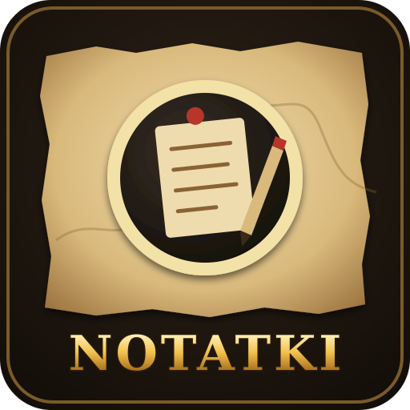

# Notatki

**World of Warcraft: Forever** addon (1.60.x, interface 16001) by **Ob-Went**.

🇵🇱 Własne notatki na mapie świata. Alt + klik na mapie albo `/notatka wróć tu na 25 lvl` w miejscu, gdzie stoisz.

🇬🇧 Your own notes on the world map. Alt + click the map, or `/notatka come back at level 25` where you stand.

## Features / Funkcje

- Alt + click on the world map opens a note dialog
- `/notatka <text>` adds a note at your position
- Notes as pins on zone and continent maps, Shift + right-click to delete
- Polish and English

## Installation / Instalacja

Copy the `Notatki` folder to `World of Warcraft\_forever_\Interface\AddOns\`.

## Commands / Komendy

| PL | EN | |
|---|---|---|
| `/notatka <tekst>` | `/note <text>` | note where you stand |
| `/notatki lista` | `/notatki list` | notes in the current zone |
| `/notatki pokaz` | `/notatki show` | show/hide notes |
| `/notatki wyczysc tak` | `/notatki clear yes` | delete notes in the current zone |
| `/notatki jezyk en` | `/notatki lang pl` | language |

## License

MIT
